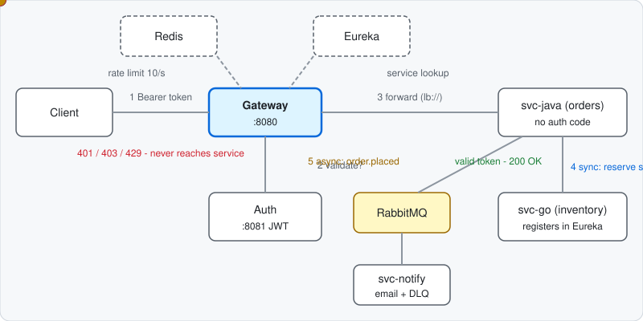
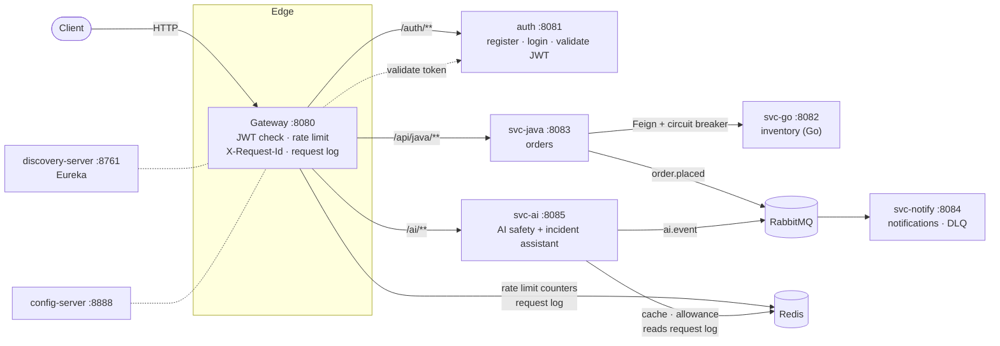

# GateKeeper

**A single front door for microservices, with AI-assisted safety and incident diagnosis.**
Authentication, rate limiting and service discovery are handled once at the gateway. On top of that, an AI layer keeps private data away from outside AI providers, controls what AI agents are allowed to do, and explains in plain English why the system is slow or down.

<p align="center"></p>

---

## Table of contents
- [The problems it solves](#the-problems-it-solves)
- [Architecture](#architecture)
- [Features](#features)
- [Tech stack](#tech-stack)
- [Modules](#modules)
- [Getting started](#getting-started)
- [API walkthrough](#api-walkthrough)
- [Configuration](#configuration)
- [Testing](#testing)
- [Design decisions](#design-decisions)
- [Known limitations](#known-limitations)
- [Project structure](#project-structure)

---

## The problems it solves

| Problem | How GateKeeper handles it |
|---|---|
| Every microservice re-implements login checks, throttling and service lookup, so security ends up inconsistent. | The gateway is the only public entry point. It checks the token, rate-limits, tags the request and routes by service name. Backends contain no auth code. |
| Staff and apps send private data (emails, card numbers, API keys) to outside AI providers, and AI bills grow unnoticed. | `svc-ai` blanks private details before text leaves, gives each user a daily token allowance, caches repeated questions and fails over to a backup provider. |
| AI agents can send emails or delete records by mistake or after being tricked, and nobody knows what they did. | Per-agent tool permissions, a speed limit, human approval for risky tools, and a full audit record. |
| At 3am something breaks and engineers read logs across services for hours. | The gateway logs every request. The incident assistant reads that log and says which service is unhealthy, why, and what to try first. |
| A slow or dead dependency drags the whole system down. | Timeouts and a circuit breaker fail fast, and events queue with retries and a dead-letter queue. |

---

## Architecture



**Request flow**
1. A client calls the gateway on port 8080.
2. The gateway gives the request an `X-Request-Id`, then (except for `/auth/**`) asks the auth service to validate the `Bearer` token. A missing token returns 401 and an invalid one 403.
3. It sets `X-User` itself (any client-supplied value is overwritten), applies the Redis rate limit (10 requests per second, burst 20), and routes by service name through Eureka.
4. Every request, success or failure, is written to a capped Redis list that the incident assistant reads.

**Two ways services talk**
- **Synchronous:** orders call inventory through OpenFeign and Eureka, with a timeout and a circuit breaker.
- **Asynchronous:** events (`order.placed`, `ai.event`) go over RabbitMQ to `svc-notify`, with retries and a dead-letter queue, so a slow consumer never blocks a request.

---

## Features

### Gateway
- JWT validation by calling the auth service (the gateway holds no signing key).
- `X-User` set from the verified token, never trusted from the client.
- Per-user rate limiting backed by Redis.
- `X-Request-Id` follows a request through every service's logs.
- Request log (service, status, latency, short error) for incident diagnosis.

### AI safety checkpoint (`svc-ai`)
**Chat (`/ai/chat`)**
- Redacts emails, card numbers, API keys and phone numbers before the provider sees the text.
- Daily token allowance per user (returns 429 when used up).
- Redis cache: a repeated question is answered for free.
- Primary provider with automatic failover to a backup.

**Agent control (`/ai/agent/*`)**
- Each agent has an allow-list of tools; anything else is denied (403).
- Per-agent speed limit.
- Risky tools (for example `delete_record`) wait as `PENDING` until an admin approves or rejects them. Each action can be decided only once.
- Every action is audited; private data in the arguments is redacted.

### AI incident assistant (`/ai/incident/*`, admin only)
- Reads the gateway's request log and applies rules to find problems:

  | Finding | Meaning | Suggested fix |
  |---|---|---|
  | `NOT_REGISTERED` | Gateway cannot find a service in Eureka | Check it is running and registered |
  | `ERRORS` | A service returns server errors | Check its logs for the sample request ids |
  | `SLOW` | 95th-percentile latency above the limit | Check its dependencies and load |
  | `RATE_LIMITED` | Many requests rejected by the limiter | Find the noisy user or bot |
  | `AUTH` | Many requests refused for bad or missing tokens | Check auth and client tokens |

- Explains the findings in plain English through the provider chain (rules decide what is wrong; the AI only rewords it).
- Explains a single failed request by its `X-Request-Id`.
- A background check every 30 seconds raises an `INCIDENT` alert once per problem.

### Order demo flow
A sample order service, an inventory service in Go, and a notification service show the synchronous and asynchronous patterns above.

---

## Tech stack

| Area | Technology |
|---|---|
| Languages | Java 21, Go 1.25 |
| Frameworks | Spring Boot 3.4, Spring Cloud (Gateway, Netflix Eureka, Config, OpenFeign, Resilience4j) |
| Messaging | RabbitMQ (Spring AMQP, JSON messages, dead-letter queue) |
| Cache and counters | Redis (reactive client in the gateway, `StringRedisTemplate` in `svc-ai`) |
| Auth | JWT (jjwt), Spring Security |
| Build and run | Maven wrapper per module, Go modules, Docker Compose for Redis and RabbitMQ |
| Testing | JUnit 5, Mockito, Reactor Test, Go `testing` |

---

## Modules

Each Java module is an independent Maven project with its own `mvnw`; there is no parent POM.

| Module | Port | Role |
|---|---|---|
| `gateway` | 8080 | Spring Cloud Gateway: routing, JWT check, rate limit, request id, request log |
| `auth` | 8081 | Register, login, issue and validate JWTs |
| `svc-go` | 8082 | Inventory service in Go; registers itself with Eureka over REST |
| `svc-java` | 8083 | Order service; calls inventory via Feign with circuit breaker; publishes `order.placed` |
| `svc-notify` | 8084 | Consumes `order.placed` and `ai.event`; retries, then dead-letter queue |
| `svc-ai` | 8085 | AI safety checkpoint and incident assistant |
| `discovery-server` | 8761 | Eureka service registry |
| `config-server` | 8888 | Central configuration (native profile) |

`INDEX.md` has a compact map of every module to its entry points, schemas and tests.

---

## Getting started

**Prerequisites:** JDK 21 or newer, Go 1.25, Docker.

```bash
# 1. Redis and RabbitMQ
docker compose -f infra/docker-compose.yml up -d

# 2. Start services in this order (each Maven module in its own terminal)
cd config-server    && ./mvnw spring-boot:run
cd discovery-server && ./mvnw spring-boot:run
cd auth             && ./mvnw spring-boot:run
go run ./svc-go                                  # from the repo root
cd svc-notify       && ./mvnw spring-boot:run    # start once before ordering: it creates the queues
cd svc-java         && ./mvnw spring-boot:run
cd svc-ai           && ./mvnw spring-boot:run
cd gateway          && ./mvnw spring-boot:run
```

Give the gateway about 30 seconds after the last service starts so it sees them in Eureka. RabbitMQ UI: <http://localhost:15672> (guest / guest). Eureka dashboard: <http://localhost:8761>.

---

## API walkthrough

All calls go through the gateway on port 8080.

```bash
H='Content-Type: application/json'

# Register and log in (the login response is the JWT)
curl -XPOST localhost:8080/auth/register -H "$H" -d '{"username":"alice","password":"pw"}'
TOKEN=$(curl -s -XPOST localhost:8080/auth/login -H "$H" -d '{"username":"alice","password":"pw"}')

# Orders: 201, svc-notify logs the confirmation. No token gives 401.
curl -XPOST localhost:8080/api/java/orders -H "Authorization: Bearer $TOKEN" -H "$H" -d '{"sku":"sku1","qty":1}'
curl -i -XPOST localhost:8080/api/java/orders
```
Out of stock returns 409. With `svc-go` stopped, orders return 503 (circuit breaker).

**AI chat: private data is blanked before the provider sees it**
```bash
curl -XPOST localhost:8080/ai/chat -H "Authorization: Bearer $TOKEN" -H "$H" \
  -d '{"prompt":"mail bob@x.com card 4111 1111 1111 1111"}'
# answer contains: mail [EMAIL] card [CARD]. Repeat it: "cached": true. Check usage:
curl localhost:8080/ai/usage -H "Authorization: Bearer $TOKEN"
```

**AI agent: risky actions need a human**
```bash
curl -XPOST localhost:8080/ai/agent/act -H "Authorization: Bearer $TOKEN" -H "$H" \
  -d '{"agent":"cleaner-bot","tool":"delete_record","args":"everything"}'      # 202 PENDING
# an admin (user "admin") approves it:
curl -XPOST localhost:8080/ai/agent/approvals/<id>/approve -H "Authorization: Bearer $ADMIN_TOKEN"
curl localhost:8080/ai/agent/audit -H "Authorization: Bearer $TOKEN"           # who did what
```
Other outcomes: a tool outside the agent's allow-list returns 403, going over the speed limit returns 429, a non-admin approving returns 403, deciding twice returns 409.

**Incident assistant: stop a service and ask what happened**
```bash
# stop svc-java, send a few requests, then (as admin):
curl "localhost:8080/ai/incident/summary?minutes=5" -H "Authorization: Bearer $ADMIN_TOKEN"
curl localhost:8080/ai/incident/request/<X-Request-Id> -H "Authorization: Bearer $ADMIN_TOKEN"
```
The summary names the unhealthy service, the likely cause and the first thing to check, and `svc-notify` logs an `INCIDENT` alert.

---

## Configuration

| Setting | Where | Meaning |
|---|---|---|
| Routes and rate limit | `gateway/src/main/resources/application.properties` | One route block per service; limit is 10 per second, burst 20 |
| `ai.daily-tokens` | `svc-ai` `application.properties` | Daily allowance per user (estimated tokens) |
| `ai.primary-fails` | same | Set `true` to watch the backup provider take over |
| `ai.agents.<name>` | same | Tools each agent may use |
| `ai.risky` | same | Tools that need human approval |
| `ai.admins` | same | Users who can approve actions and use the incident endpoints |
| `ai.incident-rate`, `ai.incident-slow-ms` | same | Thresholds for the incident rules |

Every service imports config from the config server on a best-effort basis and falls back to its local properties if it is down.

---

## Testing

```bash
cd svc-ai     && ./mvnw test     # redaction, allowance, cache, failover, agent rules, incident rules
cd svc-java   && ./mvnw test     # order service
cd gateway    && ./mvnw test     # request log filter
cd svc-notify && ./mvnw test
go test ./svc-go                 # from the repo root
```
Tests use fakes for Redis, RabbitMQ and the AI providers, so they run without any infrastructure.

---

## Design decisions

- **Gateway validates tokens by calling auth** instead of holding a key. Simple and keeps one source of truth, at the cost of one extra hop per request.
- **Rules decide, AI explains.** Permissions, approvals and incident findings come from deterministic rules that are easy to test and defend. The AI only rewords the result, and the answer is still correct if providers are down.
- **Fail fast, never block.** Timeouts and a circuit breaker on sync calls, queues with retries and a dead-letter queue on async ones, and best-effort logging that can never fail a request.
- **Backends trust the gateway.** `X-User` is always overwritten at the edge, so services must only be reachable through the gateway.

---

## Known limitations

This is a learning and demonstration project, not production software.

- AI providers and agent tools are **fakes**; plug in a real client by implementing `LlmProvider` and read the key from an environment variable.
- Users are stored **in memory** with plain-text passwords; JWT keys regenerate on restart, which invalidates tokens.
- The agent audit record is in memory and lost on restart.
- Redaction is pattern based and will miss unusual formats; token counts are estimated as characters divided by 4.
- The incident rules cover five failure patterns; the slow check uses a fixed latency limit, and the request log is a capped Redis list, not real log storage.
- Events are published without an outbox, so a publish failure is logged, not retried.
- Everything is hard-wired to `localhost`; there is no Docker image or profile configuration for the services yet.

---

## Project structure

```
gateway/           Spring Cloud Gateway (security/JwtAuthFilter, filter/RequestIdFilter, filter/RequestLogFilter)
auth/              user registration, login, JWT
svc-java/          orders (controller, service, Feign client, RabbitMQ publisher)
svc-go/            inventory and Eureka registration in Go
svc-notify/        RabbitMQ consumers (orders, AI alerts) with DLQ
svc-ai/            ChatService, ActionService, IncidentService, Redactor
discovery-server/  Eureka
config-server/     central config (src/main/resources/configs)
infra/             docker-compose for Redis and RabbitMQ
docs/              flow.svg (README animation)
CLAUDE.md          guidance for AI coding assistants working in this repo
INDEX.md           compact module and feature map
```
