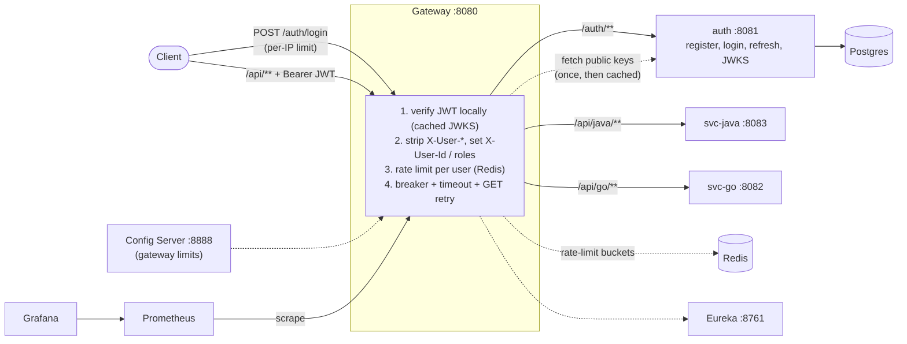

# Gatekeeper: API gateway + auth

A small microservices platform whose point is the **edge**: a Spring Cloud Gateway that authenticates requests locally (RS256 JWT + JWKS), limits traffic per user, and protects backends with timeouts, retries and circuit breakers. An `auth` service issues the tokens.

## Architecture



Backends only accept requests that carry the gateway's shared secret header, and they read the caller's identity from `X-User-Id` / `X-User-Roles`, which the gateway sets from the verified token (and which clients cannot spoof).

## Run it

```bash
docker compose up -d --build        # needs Docker
```

| What | Where |
|------|-------|
| Gateway (everything goes through here) | http://localhost:8080 |
| Eureka dashboard | http://localhost:8761 |
| Grafana dashboard (no login, local only) | http://localhost:3000 |
| Prometheus | http://localhost:9090 |

Try it:

```bash
# register, log in (returns accessToken + refreshToken)
curl -X POST localhost:8080/auth/register -H 'Content-Type: application/json' -d '{"username":"alice","password":"pass1234"}'
TOKENS=$(curl -s -X POST localhost:8080/auth/login -H 'Content-Type: application/json' -d '{"username":"alice","password":"pass1234"}')
ACCESS=$(echo "$TOKENS" | python3 -c 'import sys,json;print(json.load(sys.stdin)["accessToken"])')

curl localhost:8080/api/java/whoami -H "Authorization: Bearer $ACCESS"   # shows the propagated identity
curl -i localhost:8080/api/java/whoami                                   # 401, no token
curl -i localhost:8080/api/java/whoami -H "Authorization: Bearer $ACCESS" -H 'X-User-Id: admin'   # still your own id
curl -i localhost:8080/api/java/fail -H "Authorization: Bearer $ACCESS"  # 503 JSON fallback; repeat to open the breaker
curl localhost:8080/api/go/whoami -H "Authorization: Bearer $ACCESS"
```

Hit `/api/java/hello` in a tight loop to see `429` with `Retry-After`; hit `/auth/login` with a wrong password a few times in a row for the stricter login limit. `/auth/register` and `/auth/refresh` have their own per-IP limit (1/s, burst 5).

## Tests (no Docker needed)

```bash
for m in auth gateway svc-java config-server discovery-server; do (cd $m && mvn -B verify); done
go vet ./... && go test ./...
```

- **auth** (H2 in Postgres mode): register/duplicate/validation, login, JWKS verification, refresh rotation and reuse detection, key persistence.
- **gateway** (WireMock as backend and as JWKS): no/expired/tampered/wrong-key/wrong-issuer token → 401, header spoofing stripped, key rotation, 429 + `Retry-After`, bucket keyed by user id, timeout → 503 JSON, breaker opens and stops calling the backend, GET-only retry, Redis down → fail open.

CI (`.github/workflows/ci.yml`) runs the same plus `docker compose build`.

## Configuration

| Variable | Used by | Meaning |
|----------|---------|---------|
| `GATEWAY_SECRET` | gateway, svc-java, svc-go | Shared secret header value. **Required**: the three services refuse to start without it (no default in code). Compose supplies a demo-only value if you set none. |
| `DEMO_ENDPOINTS_ENABLED` | svc-java | Turns on `/api/java/slow` and `/fail` for timeout/breaker demos. Off by default (compose turns it on): otherwise any logged-in user could trip the breaker for everyone. |
| `AUTH_JWT_PRIVATE_KEY` | auth | PKCS#8 PEM private key. If unset, a key is generated once into `AUTH_JWT_KEY_FILE` (compose keeps it in a volume). |
| `DB_URL`, `DB_USER`, `DB_PASSWORD` | auth | Postgres connection. |
| `JWKS_URI` | gateway | Where to fetch the public keys. |
| `SVC_GO_URI`, `SVC_JAVA_URI`, `AUTH_URI` | gateway | Override route targets (default: Eureka `lb://` for Java services). |
| `GATEWAY_LIMITS_API_RATE` / `_BURST` | gateway | Per-user limit (also settable in Config Server `gateway.properties`; same for `..._LOGIN_...` and `..._AUTH_...`). |

Copy `.env.example` to `.env` to override the compose defaults.

## Security notes

- Passwords: BCrypt. Registering an existing username returns 409 and never overwrites.
- Tokens: RS256, 15 minutes, `kid` header, issuer checked. Only `auth` holds the private key. Refresh tokens are random, stored as SHA-256 hashes, rotated on use; reusing an old one revokes the whole family.
- The gateway strips every client `X-User-*` header and sets identity only from the verified token. Backends reject requests without the gateway secret.
- `/auth/validate` no longer exists (tokens in URLs end up in logs). Gateway admin endpoints are not exposed; only `/actuator/health` and `/actuator/prometheus` are public on the gateway (put them on an internal network in production).
- Known limits: no access-token revocation before expiry; the gateway secret is a static shared secret (mTLS would replace it); with Redis down, rate limiting fails open (see [ADR 002](docs/adr/002-rate-limit-fails-open.md)), including on `/auth/login`.

Decisions: [ADR 001 local JWT validation](docs/adr/001-local-jwt-validation.md), [ADR 002 fail-open rate limiting](docs/adr/002-rate-limit-fails-open.md), [ADR 003 Spring Cloud Gateway](docs/adr/003-spring-cloud-gateway.md). Concepts in plain language: [docs/concepts.md](docs/concepts.md). What's left: [docs/ROADMAP.md](docs/ROADMAP.md).

## Benchmarks

Scripts and the exact procedure are in [bench/README.md](bench/README.md). **Nothing has been measured yet**, so no numbers are claimed. Fill this table after running them (note your hardware):

| Scenario | v0-baseline (remote validation per request) | Now (local JWKS) |
|----------|----------------------------------------------|------------------|
| Authenticated GET p95 @ 50 req/s | _not measured_ | _not measured_ |
| Gateway overhead vs direct (p95) | n/a | _not measured_ |

Resume bullet (fill in measured values only): *Built a Spring Cloud Gateway edge with RS256/JWKS local JWT validation, Redis token-bucket rate limiting and Resilience4j circuit breaking; cut authenticated-request p95 latency by X% vs per-request validation; sustained N req/s on [hardware].*

## Layout

`discovery-server` (Eureka) · `config-server` (gateway limits) · `gateway` · `auth` · `svc-java` · `svc-go` · `infra/` (Prometheus, Grafana) · `bench/` (k6) · `docs/`

Stack: Java 21, Spring Boot 3.5.15, Spring Cloud 2025.0.3 (the last open-source release of that line; moving to Boot 4 is a separate migration), Go 1.25, Postgres 16, Redis 7.
