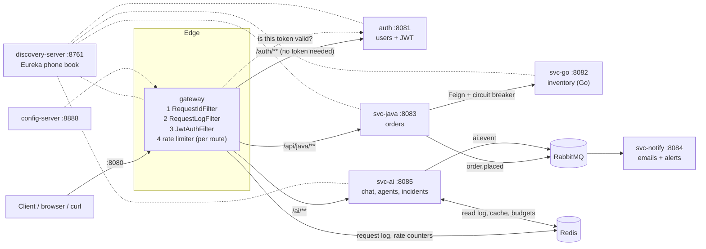

# GateKeeper: The Complete Guide (written for a college student)

This guide explains the whole project from zero. You do not need to know microservices, Spring, Redis or RabbitMQ beforehand. Each idea is introduced in plain words first, then tied to the exact file in the repo where it lives.

Everything here was checked against the source code. Where the older docs (`README.md`, `INDEX.md`, `CLAUDE.md`) disagree with the code, this guide follows the code and says so (see Part 13).

**How to read it:** Parts 1–3 give you the big picture. Parts 4–9 go service by service. Parts 10–12 show how to run it and what happens end to end. Part 13 lists the weak spots honestly. Part 14 is practice questions.

---

## Table of contents
1. What is this project, in one page
2. Vocabulary you need first (glossary)
3. The big picture: the building analogy
4. The tech stack and why each piece is there
5. Repository map: what every folder and file is for
6. The infrastructure services (config, discovery, Redis, RabbitMQ)
7. The gateway (the front door), in depth
8. The business services: auth, svc-java, svc-go, svc-notify
9. svc-ai: the "AI safety checkpoint", in depth
10. Three stories followed end to end
11. How to run it on your laptop
12. Configuration reference
13. Honest list of shortcuts, risks and bugs
14. Practice questions and ideas to extend it

---

# Part 1. What is this project, in one page

## 1.1 The one-sentence version
**GateKeeper is a small online-shop backend split into many tiny programs ("microservices"), with one guarded front door (an "API gateway") that checks who you are, limits how fast you can ask for things, tags every request with an ID, and keeps a log so a smart assistant can explain what went wrong when something breaks.**

## 1.2 The problem it is built to explore
Imagine a real online shop. It needs to:
- Know who the user is (login).
- Let the user place an order.
- Check the warehouse has the item in stock.
- Send the user a confirmation email.
- Possibly let an AI chatbot answer questions, without leaking customers' private data or running up a huge bill.
- Let the team find out quickly *why* something is broken.

You could write all of this as **one big program** (a "monolith"). That is simple at first, but as it grows, one bug can crash everything, teams step on each other, and you cannot scale just the busy part.

The alternative is **microservices**: many small programs, each doing one job, talking over the network. That solves the problems above but creates new ones, and **this project is a hands-on demonstration of those new problems and their standard fixes**:

| New problem when you split into many programs | Standard fix | Where in this project |
|---|---|---|
| Clients should not have to know 6 different addresses | One front door: **API gateway** | `gateway` |
| Every service would need its own login check | Check once, at the front door | `gateway` + `auth` |
| Services move around / restart on new addresses | A **phone book** that services register in | `discovery-server` (Eureka) |
| Settings are scattered over many programs | A **central settings server** | `config-server` |
| One user hammering the system hurts everyone | **Rate limiting** | gateway + Redis |
| When one service is dead, callers hang and crash too | **Circuit breaker** | svc-java → svc-go |
| Work like "send email" should not slow down the order | **Message queue** (async) | RabbitMQ + `svc-notify` |
| Hard to follow one request across 5 programs | A shared **request ID** | `X-Request-Id` header |
| Hard to know why it broke | **Request log + diagnosis** | gateway log → `svc-ai` incident |
| AI usage can leak data and cost money | **AI guardrails** | `svc-ai` |

## 1.3 Who is it for and where does it run?
It is a **learning / portfolio project that runs only on your own laptop**. Every address is `localhost`. There are no Dockerfiles for the services, no cloud deployment, no CI pipeline. Only two helper programs (Redis and RabbitMQ) run in Docker. It is **not** production-ready, and Part 13 explains exactly why, so you can discuss it honestly.

## 1.4 The services at a glance

| Program | Port | Language | One-line job |
|---|---|---|---|
| `config-server` | 8888 | Java | Hands out settings files to other services |
| `discovery-server` | 8761 | Java | Phone book (Eureka): "who is running where?" |
| `gateway` | 8080 | Java | The only public door; security + routing + logging |
| `auth` | 8081 | Java | Sign up, log in, create and check login tokens |
| `svc-go` | 8082 | **Go** | Inventory: how many of each item are in stock |
| `svc-java` | 8083 | Java | Orders: checks stock, saves order, announces it |
| `svc-notify` | 8084 | Java | Listens for announcements, "sends emails", logs alerts |
| `svc-ai` | 8085 | Java | AI chat guardrails, AI agent guardrails, incident assistant |
| Redis | 6379 | (Docker) | Very fast shared notepad |
| RabbitMQ | 5672 (UI 15672) | (Docker) | Post office for messages between services |

---

# Part 2. Vocabulary you need first (glossary)

Read this once; later parts will use these words freely.

**Server / service.** A program that waits for requests and answers them. "svc-java is a service."

**Port.** A number that identifies *which program* on a computer should receive a network message. A computer is like an apartment block: the IP address (`localhost` = "this machine") is the building, the port is the flat number. The gateway lives in flat 8080, auth in 8081, and so on.

**HTTP / REST API.** The language web programs use to talk. A request has a *method* (`GET` = read, `POST` = create/do something), a *path* (`/api/java/orders`), *headers* (extra labels such as `Authorization`) and optionally a *body* (usually JSON). The reply has a *status code*: `200` OK, `201` Created, `400` you sent something wrong, `401` you did not say who you are, `403` I know who you are/you are not allowed, `404` not found, `409` conflict, `429` too many requests, `500` I crashed, `502` the thing behind me failed, `503` unavailable.

**JSON.** A text format for data: `{"sku":"sku1","qty":2}`.

**Header.** A label attached to an HTTP request, like a sticker on an envelope. This project uses two custom ones: `X-User` (who is calling) and `X-Request-Id` (a tracking number).

**Microservice.** A small program that does one job and talks to others over the network.

**Monolith.** The opposite: everything in one program.

**API gateway.** A single entry point in front of all services. Think of the reception desk of a big office: visitors do not wander the floors; they talk to reception, which checks ID and sends them to the right desk.

**Service discovery (Eureka).** A phone book. Each service tells it "I am `svc-java` and I am at this address." Anyone can then ask "where is `svc-java`?" instead of hard-coding addresses. Why bother? In real life services start, stop and move constantly, and there can be several copies of one service.

**Load balancer (`lb://`).** If there are 3 copies of a service, something must pick one per request. In the gateway routes you will see `lb://svc-java`: it means "ask the phone book for `svc-java` and pick one of its copies."

**Config server.** A program that serves settings files, so settings live in one place instead of inside each program.

**JWT (JSON Web Token).** A login "wristband". After you log in you receive a long string. It contains your username and an expiry time, and it is **signed** with a secret key so nobody can forge or alter it. You show it with every request: `Authorization: Bearer <token>`. Real-world picture: a wristband at a music festival; staff only need to look at it, not re-check your ticket.

**Authentication vs authorization.** Authentication = "who are you?" Authorization = "are you allowed to do this?"

**Rate limiting.** Capping how many requests someone may send per second, so one noisy client cannot overload the system. This project uses the **token bucket** idea: you have a bucket that holds up to 20 tokens (the *burst*), each request costs one, and the bucket refills at 10 tokens per second (the *replenish rate*). So you can burst 20 requests at once, but over time only 10 per second.

**Redis.** An extremely fast in-memory database, a shared notepad that many programs can read and write. Good for counters, caches, and short-lived data. Data can be given an expiry time (TTL).

**Cache.** A saved answer so you do not recompute it. "Asked this question in the last hour? Here is the stored answer, free."

**Message queue / message broker (RabbitMQ).** A post office between programs. Program A drops a letter ("order placed") and moves on; program B picks it up whenever it is ready. A does not wait, and if B is down, the letter waits safely.
- **Exchange:** the sorting desk where messages are posted.
- **Routing key:** the label on the message (e.g. `order.placed`).
- **Queue:** the mailbox that holds messages for one reader.
- **Binding:** the rule "messages with this label go to that mailbox."
- **Dead-letter queue (DLQ):** a "returned mail" box for messages that could not be processed after several tries, so they are not lost and do not block everything.

**Synchronous vs asynchronous.** Synchronous = you ask and *wait* for the answer (a phone call). Asynchronous = you send a message and carry on (an email). Checking stock must be synchronous (we need the answer to continue). Sending a confirmation email can be asynchronous (the customer does not need to wait for it).

**Feign.** A Java library that lets you call another service's HTTP API as if it were a normal Java method.

**Circuit breaker.** Named after the electrical fuse. If a dependency keeps failing, stop calling it for a while ("open the circuit") and fail fast instead of making every user wait for a timeout. After a pause, try a few calls ("half-open") and, if they work, resume ("closed").

**Timeout.** The maximum time you will wait for an answer.

**Idempotent / outbox.** (Only mentioned in the limitations.) An *outbox* is a technique that guarantees a database change and the message about it are never out of sync. This project deliberately does not use it.

**Spring Boot.** A Java framework that makes it quick to build web programs. **Spring Cloud** is an add-on family that provides the microservice parts (gateway, Eureka, config, Feign, circuit breakers).

**Maven / `mvnw`.** The Java build tool. `./mvnw` is a small script in each folder that downloads the right Maven version so you do not need to install it.

**Reactive / WebFlux.** A style of Java programming that handles many requests with few threads by never blocking. The gateway uses it because a gateway mostly waits on other services; the other Java services use the simpler classic style.

**Redact.** Blank out sensitive pieces of text, e.g. turn `me@mail.com` into `[EMAIL]`.

**LLM provider.** A company/service that runs a large language model (the AI behind a chatbot). In this project they are fakes.

---

# Part 3. The big picture: the building analogy

Picture a **busy office building**:

- **The front desk and security (gateway).** Everyone enters here. A guard checks your wristband (JWT), gives you a visitor tracking sticker (request ID), counts how often you walk in (rate limit) and writes every visit in a logbook (request log).
- **The staff directory (Eureka).** A board saying which department is in which room today.
- **The notice board for rules (config server).** Company policy that departments read.
- **HR (auth).** Issues the wristbands, and also checks if a wristband is genuine when the guard asks.
- **Sales (svc-java).** Takes your order.
- **Warehouse (svc-go).** Says whether the item is in stock.
- **Mailroom (RabbitMQ) and the clerk (svc-notify).** Sales drops a note "order placed"; the clerk reads it and sends the customer an email.
- **The compliance officer (svc-ai).** Looks after AI use: stops private data leaving the building, keeps a per-person AI budget, requires a manager's signature for dangerous robot actions, and reads the front-desk logbook to explain problems in plain English.
- **The whiteboard (Redis).** Quick shared scribbles: counters, saved answers, the logbook.

## 3.1 The diagram



Solid arrows = real traffic. Dotted = supporting relationships (registering, looking up, reading settings).

## 3.2 Two kinds of communication, and why both
1. **Synchronous (HTTP):** client → gateway → service, and svc-java → svc-go. Used when the caller *needs the answer now*.
2. **Asynchronous (RabbitMQ):** svc-java → svc-notify, and svc-ai → svc-notify. Used for "tell someone, don't wait" work. **Why:** if the email system is slow or down, the customer's order must still succeed.

## 3.3 Design principle that runs through everything
The authors repeatedly choose **the simplest thing that demonstrates the idea**, and mark shortcuts with comments starting `shortcut:` (for example in `eureka.go`, `ChatService.java`, `OrderService.java`, `ActionService.java`). So when you see in-memory maps instead of a database, that is a deliberate choice, not forgetfulness. Part 13 lists them all.

---

# Part 4. The tech stack and why each piece is there

## 4.1 Languages and versions
| Thing | Version | Where it is set | Why |
|---|---|---|---|
| Java | **21** | `<java.version>21</java.version>` in every `pom.xml` | Current long-term-support version. (README/CLAUDE.md say 17; the POMs say 21 and are right.) |
| Spring Boot | **3.4.1** | `spring-boot-starter-parent` in each POM | Standard Java web framework |
| Spring Cloud | **2024.0.1** (BOM) | `spring-cloud-dependencies` in each POM | Gives gateway, Eureka, config, Feign. A "BOM" is a list that pins compatible versions of many libraries together |
| Go | **1.25.2** | `go.mod` at repo root | Used for svc-go. Standard library only, no outside packages |

**Why is one service written in Go?** To show that in a microservice world services can be written in *different languages* and still cooperate, since all they share is HTTP and JSON. It also forces the Go service to join Eureka by hand (Part 8.3), which teaches how Eureka really works underneath.

## 4.2 Libraries per service
| Service | Main libraries | What for |
|---|---|---|
| gateway | Spring Cloud Gateway, WebFlux, LoadBalancer, Eureka client, Config client, Reactive Redis | Routing, non-blocking, find services by name, rate limiter storage, request log |
| auth | Spring Web, Spring Security, jjwt 0.13.0, Actuator, Eureka and Config clients | Endpoints, JWT creation/validation |
| svc-java | Spring Web, OpenFeign, Resilience4j circuit breaker, AMQP (RabbitMQ), Eureka client | Order API, call svc-go safely, publish events |
| svc-ai | Spring Web, Data Redis, AMQP, Eureka and Config clients, scheduling | AI guardrails |
| svc-notify | Spring Web, AMQP | Consume messages |
| config-server | Spring Cloud Config Server | Serve settings |
| discovery-server | Eureka Server | Phone book |
| svc-go | Go `net/http`, `encoding/json`, `sync` | Inventory and Eureka registration |

Notes:
- `auth/pom.xml` also includes **Spring Data JPA and H2** (a database library) but nothing uses them. It is leftover; users are kept in a plain Java map.
- svc-notify does **not** use Eureka or the config server. It only needs to talk to RabbitMQ.

## 4.3 Data stores
**There is no real database.** This is the most important fact to tell a reviewer. State lives in:
| What | Where | Lost on restart? |
|---|---|---|
| Users | `ConcurrentHashMap` in auth `UserService` | Yes |
| Orders | `ConcurrentHashMap` in svc-java `OrderService` | Yes |
| Stock | Go map with a mutex in `svc-go/inventory.go` | Yes (reset to the seed) |
| Agent audit log | `ConcurrentHashMap` in svc-ai `ActionService` | Yes |
| Request log, rate-limit counters, AI cache, AI budgets, agent counters | **Redis** | Only if Redis is restarted without persistence; most have expiry times anyway |

**Why:** a database would add schema, migrations and connection code that distract from the real lesson (distributed-systems patterns). The trade-off is that nothing is durable.

## 4.4 Tooling
- **Build:** Maven wrapper per module (`<module>/mvnw`). **There is no parent POM**, so the 7 Java modules are 7 independent projects. Simple, but version numbers are repeated everywhere.
- **Docker:** only `infra/docker-compose.yml` (Redis 7 and RabbitMQ 3 with the management UI).
- **Tests:** JUnit 5 for Java, Go's built-in `testing` for Go.
- **Not present:** CI/CD, Dockerfiles for the services, linters, Kubernetes/Terraform.

---

# Part 5. Repository map: what every folder and file is for

```
gatekeeper/
├── README.md             Public explanation + animated diagram (287 lines)
├── CLAUDE.md             Notes for the AI coding assistant working on this repo
├── INDEX.md              Compact lookup table: feature → file → test
├── REPO_DEEP_DIVE.md     This document
├── go.mod                Go module definition. It sits at the REPO ROOT, not in svc-go/
├── .gitignore            Ignores target/, bin/, .env, logs, IDE files, INTERVIEW_PREP.md
├── docs/flow.svg         The animation shown in the README
├── infra/
│   └── docker-compose.yml     Starts Redis and RabbitMQ
├── config-server/        :8888
├── discovery-server/     :8761
├── gateway/              :8080
├── auth/                 :8081
├── svc-go/               :8082  (Go; main.go, inventory.go, eureka.go, inventory_test.go)
├── svc-java/             :8083
├── svc-notify/           :8084
└── svc-ai/               :8085
```
Java layout inside each module: `src/main/java/com/gatekeeper/<package>/` for code, `src/main/resources/` for settings, `src/test/java/...` for tests. Package names use underscores (`svc_java`, `config_server`) because Java packages cannot contain hyphens.

## 5.1 Every source file and its job

### config-server
| File | Job |
|---|---|
| `ConfigServerApplication.java` | Starts the config server (`@EnableConfigServer`) |
| `resources/application.properties` | Port 8888, `native` profile (read files from disk instead of Git), search folder `classpath:/configs` |
| `resources/configs/auth.properties` | Name + port for auth |
| `resources/configs/gateway.properties` | Name + port for gateway |
| `resources/configs/src-java.properties` | Name + port for svc-java. **Name is a typo**: the server matches files by application name, and the app is `svc-java`, so this file is never served |
| `resources/configs/svc-ai.properties` | Name + port for svc-ai |

### discovery-server
| File | Job |
|---|---|
| `DiscoveryServerApplication.java` | Starts Eureka (`@EnableEurekaServer`) |
| `resources/application.properties` | Port 8761; does not register with itself or fetch a registry (it *is* the registry) |

### gateway
| File | Job |
|---|---|
| `GatewayApplication.java` | Starts the app; defines the load-balanced `WebClient.Builder` (used to call auth by name) and the `userKeyResolver` (decides *whose* rate-limit bucket a request uses) |
| `filter/RequestIdFilter.java` | Gives each request a tracking ID |
| `filter/RequestLogFilter.java` | Writes one log line per request into Redis |
| `security/JwtAuthFilter.java` | Checks the login token by asking auth |
| `resources/application.properties` | The **route table** and rate-limit settings |
| `resources/bootstrap.properties` | Name, config-server and Eureka addresses |
| `test/.../RequestLogFilterTest.java` | 2 tests for the log filter |
| `test/.../GatewayApplicationTests.java` | Checks the app context loads |

### auth
| File | Job |
|---|---|
| `AuthApplication.java` | Starts the app |
| `controller/AuthController.java` | Three endpoints: register, login, validate |
| `service/UserService.java` | Stores users in a map |
| `jwt/JwtUtil.java` | Creates and checks tokens |
| `model/User.java` | Plain object with username and password |
| `security/SecurityConfig.java` | Spring Security set to "allow everything", CSRF off |

### svc-java (orders)
| File | Job |
|---|---|
| `SvcJavaApplication.java` | Starts the app; `@EnableFeignClients` |
| `controller/OrderController.java` | `POST /api/java/orders`, `GET /api/java/orders/{id}`; checks input |
| `controller/HealthController.java` | `GET /api/java/health` |
| `service/OrderService.java` | The business logic: reserve stock, save, announce |
| `client/InventoryClient.java` | Feign interface describing svc-go's reserve endpoint |
| `event/OrderPlaced.java` | The "order placed" record, used as both the saved order and the message |
| `config/RabbitConfig.java` | Declares the `orders` exchange and JSON message conversion |
| `test/.../OrderServiceTest.java` | 4 tests of the order logic |

### svc-go (inventory)
| File | Job |
|---|---|
| `main.go` | Starts the server on 8082, `/health`, seeds stock, registers in Eureka, deregisters on Ctrl-C |
| `inventory.go` | `GET /inventory/{sku}` and `POST /inventory/{sku}/reserve` |
| `eureka.go` | Registers with Eureka via raw HTTP calls, heartbeats every 30 s |
| `inventory_test.go` | A Go test of the reserve logic |

### svc-notify
| File | Job |
|---|---|
| `SvcNotifyApplication.java` | Starts the app |
| `RabbitConfig.java` | Creates the queues, the dead-letter queue and the bindings |
| `OrderListener.java` | Handles "order placed" messages (pretends to email) |
| `AiEventListener.java` | Handles AI alert messages (logs a warning) |
| `resources/application.properties` | Port 8084, RabbitMQ host, retry rules |

### svc-ai
| File | Job |
|---|---|
| `SvcAiApplication.java` | Starts the app with property scanning and scheduling enabled |
| `AiController.java` | All `/ai/...` endpoints |
| `ChatService.java` | Chat guardrails (redact, cache, budget, failover) |
| `ActionService.java` | AI agent guardrails (permissions, speed limit, approval, audit) |
| `IncidentService.java` | Reads the request log, diagnoses, explains, alerts |
| `Redactor.java` | Removes private data from text |
| `LlmProvider.java` | The tiny interface "give me a prompt, I return an answer" |
| `AiConfig.java` | Creates the two fake providers and the `ai` exchange |
| `AiProps.java` | Typed access to all `ai.*` settings, plus the admin check |
| `Events.java` | Publishes alerts to RabbitMQ, never failing the caller |
| `AiEvent.java` | The alert message shape |
| `test/.../AiTest.java` (7), `IncidentTest.java` (7) | Tests of the guardrails and diagnosis rules |

## 5.2 Where is the "database schema"? Where are "migrations"?
Nowhere; there is no SQL database. The only "schemas" are (a) the JSON shape of messages and Redis entries, (b) the Java records listed in later parts.

---

# Part 6. The infrastructure services

These four are not "business" features; they are the plumbing that makes the others work.

## 6.1 config-server (port 8888): the central settings office

**Idea.** Instead of every service owning its settings, they can ask a server: "I am `gateway`, give me my settings."

**How it works here.** It runs in `native` mode, which means it reads plain files from its own `configs/` folder. A service named `gateway` receives `configs/gateway.properties`. (In real projects the files usually live in a Git repository.)

**What is actually in the files?** Almost nothing: just the app name and port. This is a **demonstration of the mechanism**, not a place where important settings live. The real settings are still in each service's own `application.properties`.

**The key detail: `optional:`.** Every client uses `spring.config.import=optional:configserver:http://localhost:8888`. The word `optional:` means "if the config server is not there, carry on anyway". **Why:** so services still start when you did not launch the config server. **Cost:** a failure is *silent*; you could believe you are using central config when you are really using local files.

**Gotcha.** Because the name/port values are copied in two places (the service's own properties and the config-server file), they must be kept in sync by hand.

## 6.2 discovery-server (port 8761): Eureka, the phone book

**Idea.** Services register themselves with a name and address. Others look names up.

**How it works.**
1. A service starts and sends Eureka: "I am `SVC-JAVA`, at localhost:8083."
2. It sends a **heartbeat** every ~30 seconds saying "still alive."
3. If heartbeats stop, Eureka removes it from the list.
4. The gateway asks "who is `svc-java`?" and gets the address.

**Setting here.** `register-with-eureka=false` and `fetch-registry=false`: Eureka does not list itself in itself. You can open `http://localhost:8761` in a browser to see the dashboard of registered services; that is the first place to look when something "cannot be found".

**Why a phone book at all, when everything is on localhost?** Because the *point* is to learn how it works in a real setup, where there may be many copies of a service on changing addresses. The routes say `lb://svc-java`, never `localhost:8083`.

## 6.3 Redis (port 6379): the shared fast notepad

Run through Docker. It is used by two services for five different things:

| Key pattern | Written by | Purpose | Expiry |
|---|---|---|---|
| (internal keys) | gateway rate limiter | Token buckets | managed by Spring |
| `incidents:requests` (a list) | gateway `RequestLogFilter` | One JSON line per request, newest first, max 5000 | trimmed by count |
| `ai:cache:<sha256 of prompt>` | svc-ai | Saved AI answers | 1 hour |
| `ai:budget:<user>:<date>` | svc-ai | Tokens used today | 1 day |
| `ai:agent:<agent>:<minute>` | svc-ai | Actions this minute | 2 minutes |

**Why Redis and not a map in each program?** The gateway and svc-ai are *different programs*, yet svc-ai must read what the gateway logged. They need a place both can reach. Redis is that shared place, and it is built for fast counters and expiring data.

## 6.4 RabbitMQ (ports 5672 and 15672): the post office

Run through Docker. You can open the management UI at `http://localhost:15672` (username `guest`, password `guest`) to see queues and messages.

**Layout of this project's mail system:**

```
 svc-java ──post──▶ exchange "orders" ──(label order.placed)──▶ queue orders.notify ──▶ svc-notify OrderListener
 svc-ai   ──post──▶ exchange "ai"     ──(label ai.event)─────▶ queue ai.notify     ──▶ svc-notify AiEventListener

 a message that fails 3 times ──▶ dead-letter queue "orders.notify.dlq"
```

**Who creates what, and why this matters.** The sender (producer) declares only the *exchange*. The reader (consumer, svc-notify) declares the *queues and bindings*. That is why **svc-notify must be started at least once before you place an order**: until the queue and binding exist, RabbitMQ has nowhere to put the message and silently throws it away. (Producer-owns-exchange, consumer-owns-queue is a common pattern: the reader best knows how it wants to receive mail and what to do on failure.)

---

# Part 7. The gateway (the front door), in depth

File area: `gateway/`. Built with **Spring Cloud Gateway**, which is *reactive* (non-blocking).

**Why reactive?** A gateway does almost no work of its own; it mostly waits for other services. A classic "one thread per request" design wastes a thread for each wait. A reactive design lets a handful of threads juggle thousands of waiting requests. (The rest of the Java services use the simpler classic model since they are not the bottleneck.)

## 7.1 The route table (`gateway/src/main/resources/application.properties`)

| Route id | Matches path | Sends to | Rate limit |
|---|---|---|---|
| `auth` | `/auth/**` | `lb://auth` | none |
| `svc-java` | `/api/java/**` | `lb://svc-java` | 10/s, burst 20 |
| `svc-ai` | `/ai/**` | `lb://svc-ai` | 10/s, burst 20 |

`**` means "this and anything below it." **svc-go is not routed**; it can only be reached by svc-java (or directly on port 8082 on your laptop). **Why:** inventory is an internal detail; outsiders should only go through the order service.

Each route's *id* matters later: the request log uses it as the service name.

## 7.2 The chain of filters a request passes through

A *filter* is a checkpoint a request must go through, in order. The order is deliberate:

```
Request arrives
   │
   ▼
① RequestIdFilter     (@Order HIGHEST_PRECEDENCE)       "give it a tracking number"
   ▼
② RequestLogFilter    (@Order HIGHEST_PRECEDENCE + 1)   "start a stopwatch; write the log line when done"
   ▼
③ JwtAuthFilter       (default order)                    "is the wristband valid?"
   ▼
④ Route matching → RequestRateLimiter (route filter)     "have you asked too often?"
   ▼
⑤ Forward to the chosen service
```

**Why is the logger placed right after the ID filter and before the auth filter?** So that rejected requests (401, 403) are also logged. If logging happened after auth, failures at the door would be invisible.

### ① `RequestIdFilter`: the tracking number
- Reads the header `X-Request-Id`. If missing or blank, creates a random UUID.
- Puts the ID on the **response** (so the client sees it) and on the **forwarded request** (so every service sees it).
- **Why:** an order touches the gateway, svc-java, svc-go and svc-notify. Without one shared ID you cannot tell which log lines belong together. With it, you search all logs for one ID and see the whole story. This is the baby version of "distributed tracing."

### ② `RequestLogFilter`: the logbook
For every request, after it finishes (or fails), it builds one JSON line:
```json
{"ts":1730000000000,"requestId":"…","service":"svc-java","path":"/api/java/orders","status":201,"latencyMs":42,"error":null}
```
- `service` is the **route id** (`auth`, `svc-java`, `svc-ai`), or `unrouted` if no route had been chosen yet.
- It pushes the line to the front of the Redis list `incidents:requests` and trims the list to the newest 5000 entries.
- It is **fire-and-forget**: the push is not awaited, and any failure is just logged as a warning. **Why:** logging must never slow down or break a real customer request.
- It **never stores bodies or headers**, so passwords and tokens do not end up in the log. **Why:** privacy; the log is later read by an AI assistant.

### ③ `JwtAuthFilter`: the wristband check
Step by step:
1. If the path starts with `/auth`, let it through (you must be able to register and log in without a token).
2. Otherwise read `Authorization: Bearer <token>`. If it is missing or does not start with `Bearer ` → respond **401**.
3. Call `http://auth/auth/validate?token=<token>` (by *name*, through the load-balanced `WebClient`).
4. If the answer is the literal text `Invalid token`, **or the call fails for any reason** → respond **403**.
5. Otherwise the answer is the username. Attach it as header `X-User`, **overwriting** anything the client may have sent, and continue.

**Why check by calling auth instead of verifying the token inside the gateway?**
- *For:* the gateway needs no secret key and no JWT library; the key lives in exactly one place (auth). A leaked or rotated key affects one program.
- *Against:* every single request costs an extra network hop to auth, and if auth is down nobody can do anything. Also the token goes in a URL query string, which can show up in logs. Many real systems verify the signature locally in the gateway for speed. This project chooses the simpler-to-reason-about option.

**Why overwrite `X-User`?** Otherwise an attacker could send their own `X-User: admin` header and the services behind the gateway, which trust that header, would believe them. Overwriting means *only the gateway* can say who the user is.

### ④ `RequestRateLimiter`: the speed limit
- Only on `svc-java` and `svc-ai` routes.
- Backed by Redis, so it works even with several gateway copies.
- The bucket **key** comes from `userKeyResolver` in `GatewayApplication`: the bearer token if present, otherwise the caller's IP address.
- **Why per token?** So one heavy user is slowed down without punishing everyone else.
- When you exceed it the gateway answers **429 Too Many Requests**.

## 7.3 What `GatewayApplication` also does
- `@EnableDiscoveryClient`: registers with Eureka and uses it to resolve `lb://` names.
- `@LoadBalanced WebClient.Builder`: a web client that understands service names like `http://auth/...`. The `JwtAuthFilter` is built from it. Without `@LoadBalanced`, the name `auth` would be treated as an internet hostname and fail.

---

# Part 8. The business services

## 8.1 auth (port 8081): who are you?

### Endpoints (`AuthController`, base path `/auth`)
| Endpoint | Does | Returns |
|---|---|---|
| `POST /auth/register` body `{username,password}` | Stores the user in a map | `"User registered successfully"` |
| `POST /auth/login` body `{username,password}` | Compares password; if equal, creates a token | the token string, or `"Invalid credentials"` (with HTTP **200**) |
| `GET /auth/validate?token=...` | Checks the token | the username, or `"Invalid token"` |

### How the token works (`JwtUtil`)
- **Creating:** `Jwts.builder()` with the username as *subject*, expiry = now + 1 hour, signed with an **HS256** key.
- **Checking:** parse and verify the signature and expiry; on any exception return `null`, which the controller turns into `"Invalid token"`.
- **The key** is generated randomly at startup (`Keys.secretKeyFor`). Consequences: restarting auth logs everybody out, and two auth copies could not accept each other's tokens. **Why:** zero setup. Production would load a stable secret from a vault or environment variable.

### Why `SecurityConfig` allows everything
Spring Security is on the classpath, and by default it would block all endpoints with a login page. `SecurityConfig` turns that off (`permitAll`, CSRF disabled) because this project does its *own* token logic. The real security boundary is the gateway.

### Be honest about what is weak
- Passwords are saved and compared as **plain text** (a comment in `User.java` says "we will hash later"). Real systems store a salted hash (bcrypt/argon2).
- A wrong password returns HTTP 200 with a text message instead of 401.
- Registering an existing username silently **overwrites** that user's password.

## 8.2 svc-java (port 8083): the order desk

### Endpoints
| Endpoint | Does |
|---|---|
| `POST /api/java/orders` body `{sku, qty}` | Places an order |
| `GET /api/java/orders/{id}` | Fetches an order (404 if unknown) |
| `GET /api/java/health` | Returns `svc-java healthy ✅` |

### What `OrderController.place` checks
1. No `X-User` header → **401** (only the gateway sets it, so a direct call without it is refused).
2. `sku` missing/blank, or `qty <= 0` → **400** `sku and positive qty required`.
3. Uses the incoming `X-Request-Id`, or makes one if absent.

### What `OrderService.place` does (the heart of the shop)
```
1. Ask svc-go: "reserve qty of sku, here's the request id"
      ├─ exception (timeout, connection refused, breaker open) → 503 "inventory unavailable"   (nothing stored)
      └─ answer reserved=false                                   → 409 "out of stock"          (nothing stored)
2. Create an OrderPlaced with a random UUID and store it in the map
3. Publish OrderPlaced to RabbitMQ exchange "orders", key "order.placed"
      └─ publish fails → log an ERROR, but still return success
4. Return the order with HTTP 201
```

**Why reserve stock *before* saving the order?** An order for something we do not have is worse than a stock reservation without an order. Failing early and storing nothing keeps things simple.

**Why swallow a publish failure?** The customer already has a valid order; failing the whole request over a missing email would be worse. The cost: a lost notification that nobody retries. The code comment names this as a deliberate shortcut and says the upgrade is a **transactional outbox** (save the order and the "to-send" message in one database transaction, then a background job delivers it). Without a real database that upgrade is not possible here.

### The Feign client (`InventoryClient`)
```java
@FeignClient(name = "svc-go")
POST /inventory/{sku}/reserve   body {qty}   header X-Request-Id → {reserved, remaining}
```
- `name = "svc-go"` means Eureka will be asked where `svc-go` is.
- **Why is `X-Request-Id` a method parameter rather than copied automatically?** The circuit breaker runs the call on a different thread, where the "current request" is no longer available, so the ID would be lost. Passing it explicitly is the reliable fix (the comment in the file says so).

### The safety settings (`svc-java/application.properties`)
| Setting | Value | Plain meaning |
|---|---|---|
| Feign connect timeout | 1000 ms | Give up connecting after 1 s |
| Feign read timeout | 2000 ms | Give up waiting for the answer after 2 s |
| Time limiter | 3 s | Whole call may not exceed 3 s |
| Circuit breaker window | 5 calls | Look at the last 5 calls |
| Minimum calls | 3 | Do not judge until at least 3 calls |
| Failure threshold | 50 % | Open if half or more fail |
| Open duration | 10 s | Refuse calls for 10 s, then test again |

**Example.** svc-go is switched off. Order 1, 2, 3 each fail after a short wait → 3 of 3 failed (100 % ≥ 50 %) → the breaker **opens**. Order 4 now fails *instantly* with 503 without even trying the network. After 10 s a few trial calls go through; if they work, normal service resumes. This stops svc-java from piling up slow, stuck requests and falling over itself.

### Event message shape (`OrderPlaced`)
`{orderId, user, sku, qty, requestId}`, exchange `orders`, routing key `order.placed`. The same record is the saved order, the HTTP response and the message.

## 8.3 svc-go (port 8082): the warehouse (written in Go)

### Data
At startup: `{"sku1": 5, "sku2": 2}`; five of `sku1`, two of `sku2`. Protected by a `sync.Mutex` ("only one goroutine may touch the map at a time").

### Endpoints
| Endpoint | Does |
|---|---|
| `GET /health` | Text `Go service healthy` |
| `GET /inventory/{sku}` | `{"remaining": n}` (0 if unknown) |
| `POST /inventory/{sku}/reserve` body `{"qty":N}` | Reserve if enough stock |

### How `reserve` works
1. Decode the body; if invalid or `qty <= 0` → **400**.
2. Lock the mutex. `ok = stock[sku] >= qty`. If ok, subtract. Read the remaining. Unlock.
3. Log the line with the request ID.
4. Reply `{"reserved": ok, "remaining": left}`.

**Why the lock covers both the check and the subtraction.** If two orders for the last item arrive at the same moment, without the lock both could see "1 left" and both subtract: stock goes negative (an *oversell*). Holding the lock across check + subtract makes that impossible.

**Why does out-of-stock return HTTP 200 with `reserved:false` and not an error code?** The circuit breaker in svc-java counts *errors* as failures. "Out of stock" is a normal business outcome, not a broken service. If it were an error, a popular item selling out could trip the breaker and block orders for *other* items. (The comment in `inventory.go` explains this.)

### Registering with Eureka by hand (`eureka.go`)
Java services get Eureka registration for free from a library. Go has none here, so the code speaks Eureka's REST API directly:
1. `POST http://localhost:8761/eureka/apps/SVC-GO` with a JSON "instance" description: id `localhost:svc-go:8082`, host `localhost`, port 8082, status `UP`.
2. A background goroutine sends `PUT .../apps/SVC-GO/<id>` every 30 s as a heartbeat. If Eureka replies **404** (it restarted and forgot us), it registers again.
3. On Ctrl-C, `main.go` catches the signal, sends `DELETE` to unregister cleanly, then exits.

The comment marks the shortcut: the host is hard-coded to `localhost`.

## 8.4 svc-notify (port 8084): the mail clerk

It has no HTTP features of its own; it only **listens**.

### Queues it creates (`RabbitConfig`)
| Queue | Bound to | Dead-letter target |
|---|---|---|
| `orders.notify` | exchange `orders`, key `order.placed` | `orders.notify.dlq` |
| `ai.notify` | exchange `ai`, key `ai.event` | `orders.notify.dlq` |
| `orders.notify.dlq` | (none; the returned-mail box) | |

(The AI queue also dead-letters into the same `orders.notify.dlq`; a small naming oddity.)

### `OrderListener`
Receives `OrderPlaced`. If `user` is null it **throws** on purpose (a malformed message); otherwise it logs `email sent to <user>: order … confirmed`. No real email is sent.

### Retry rules (`application.properties`)
- Retry enabled, **3 attempts**, first wait 1 s.
- `default-requeue-rejected=false`: after the 3rd failure, do **not** put it back in the queue (that would loop forever); the broker moves it to the dead-letter queue instead.

**Why:** a "poison message" that can never succeed must not block everyone behind it. The DLQ keeps it safe for a human to inspect.

### `AiEventListener`
Receives AI alerts (`BUDGET_80`, `ACTION_PENDING`, `INCIDENT`) and logs `[ALERT kind] user: detail` at warning level. This stands in for "page the on-call engineer / send a Slack message".

### Why does svc-notify define its own `OrderPlaced` and `AiEvent` types?
The comment says: "services share the JSON contract, not a class." If both services imported one shared Java class, they would be tied together at build time and could not be changed or deployed independently. Each side declares what it needs from the JSON.

---

# Part 9. svc-ai: the "AI safety checkpoint", in depth

**What is the problem?** Companies want to let staff and software use AI, but worry about three things: (1) private data being sent to an outside AI company, (2) cost running away, (3) AI "agents" that can *do* things (delete a record, send an email) doing something harmful. svc-ai is a checkpoint that sits between users and the AI, applying rules. It has three features.

**Important:** the AI itself is **fake**. `AiConfig` defines two providers that just echo your prompt with `[primary]` or `[backup]` in front. **Why:** tests and demos cost nothing and need no API key. To use a real AI you would write a class implementing the one-method `LlmProvider` interface and put it in the list. The guardrails around it would not change.

All endpoints sit under `/ai/` and trust the `X-User` header the gateway sets.

## 9.1 Feature A: Chat guardrails (`ChatService`, `POST /ai/chat`)

Request body: `{"prompt":"..."}`. Reply: `{answer, cached, tokensUsed}`.

### The pipeline, in order
```
prompt ─▶ ① Redact private data
        ─▶ ② Look in the cache ── hit ──▶ return saved answer (cached=true, costs 0)
        ─▶ ③ Estimate tokens, check the daily allowance ── over ──▶ 429
        ─▶ ④ Ask provider 1; if it fails, provider 2; if both fail ──▶ 502
        ─▶ ⑤ Save in cache (1 hour), add to the user's usage, maybe raise an 80% alert
```

**① Redaction (`Redactor`).** Regex patterns replace:
| Pattern | Replaced with |
|---|---|
| email address | `[EMAIL]` |
| 13–16 digit number with optional spaces/dashes (card) | `[CARD]` |
| keys starting `AKIA…`, `sk-…`, `ghp_…` | `[SECRET]` |
| phone-like digit sequences | `[PHONE]` |

*Why first?* Everything after this step (cache key, provider call, logs) only ever sees the cleaned text, so private data never leaves the company. *Limit:* it is pattern-based and will miss unusual formats; the file's comment says so. Order matters too: the card pattern runs before the phone one so a card number is not mis-labelled.

**② Cache.** Key = `ai:cache:` + SHA-256 hash of the *redacted* prompt. Why hash? Keys stay short and fixed-size, and the raw prompt text is not exposed as a key. Why redacted? Two prompts differing only by an email address share one cached answer, and no private data is stored. A cache hit is free and does not spend the allowance.

**③ Daily allowance.** `tokens ≈ max(1, length / 4)` (a rough rule of thumb; a real provider reports real counts). The allowance is `ai.daily-tokens` = **200**. Example: a 400-character prompt ≈ 100 tokens. The user has 200 a day. A second *different* 400-character prompt reaches 200, which is allowed (the check is `used + tokens > limit`). A third is refused with 429 `daily AI allowance used up`. The counter key includes the date, so it naturally resets tomorrow, and also expires after a day.

**④ Failover.** `callProviders` loops through the providers sorted by `@Order` (primary = 1, backup = 2). If one throws, it logs and tries the next. Set `ai.primary-fails=true` to *see* failover: answers will start with `[backup]`. If every provider throws → **502** `all AI providers are down`.

**⑤ 80 % alert.** After spending, if the user crossed from below 80 % to at-or-above 80 % of the allowance in *this* call, publish an event `BUDGET_80` ("160/200 tokens used today"). It fires once on the crossing, not on every later call. svc-notify logs it.

`GET /ai/usage` returns `{user, tokensUsedToday, dailyAllowance}`.

## 9.2 Feature B: Agent guardrails (`ActionService`, `/ai/agent/*`)

**Background.** An *AI agent* is a program that uses an AI to decide on actions (use *tools* like "send an email"). Dangerous if unchecked. This feature controls what each agent may do.

### Settings (`svc-ai/application.properties`)
```
ai.agents.support-bot  = read_record, send_email
ai.agents.cleaner-bot  = read_record, delete_record
ai.risky               = delete_record, send_email      (need human approval)
ai.agent-per-minute    = 10
ai.admins              = admin
```

### Decision flow for `POST /ai/agent/act` `{agent, tool, args}`
```
args → redacted
1. Is `tool` in this agent's allow-list?              no → DENIED        (HTTP 403)
2. More than 10 actions this minute for this agent?   yes → RATE_LIMITED (HTTP 429)
3. Is the tool in the risky list?                     yes → PENDING      (HTTP 202) + alert ACTION_PENDING
4. Otherwise                                              → EXECUTED     (HTTP 200)
```
Every outcome is written to the **audit log** with id, time, user, agent, tool, args, status and result. This answers "who did what, when, and who approved it?"

**The rate-limit counter** is the Redis key `ai:agent:<agent>:<current minute number>`, incremented each time, expiring after 2 minutes. The "minute number" is `currentTimeMillis / 60000`, so each minute gets a fresh counter automatically.

**Examples**
- `support-bot` + `read_record` → `EXECUTED` immediately.
- `support-bot` + `delete_record` → `DENIED` (not on its list).
- `cleaner-bot` + `delete_record` → `PENDING`: nothing is deleted yet; a human must approve.
- `support-bot` + `send_email` → `PENDING` (allowed to use it, but it is risky).

### Human approval (`decide`)
`POST /ai/agent/approvals/{id}/approve` or `/reject`:
1. `requireAdmin(user)`: the user must be in `ai.admins`, else **403**.
2. Unknown id → 404. Not `PENDING` → 409 `already decided`.
3. Approve → status `EXECUTED` and the (fake) tool runs; reject → `REJECTED`.
4. Saved with `audit.replace(id, oldEntry, newEntry)`, a **compare-and-swap**: it succeeds only if the stored entry is still the exact `PENDING` one we read. If two admins double-click at once, only one wins; the other gets 409, so the action cannot run twice.

`GET /ai/agent/audit?status=PENDING` lists records, oldest first, optionally filtered.

**The tool "execution"** is just a string: `ran <tool>(<args>)`. Real tools would be called there.

## 9.3 Feature C: The incident assistant (`IncidentService`, `/ai/incident/*`)

**The problem.** At 3 a.m. something breaks. Engineers want to know *which service is unhealthy, why, and what to try first*, in plain words.

**The design idea, which is the smartest part of the project: rules decide, AI only rewords.** Asking an AI "what's wrong?" directly can produce confident nonsense. So deterministic code (`diagnose`) works out the facts from data, and the AI only turns those facts into friendly English. If the AI is down, the raw rule text is returned and is still a complete answer.

### The data source
The gateway's request log in Redis (`incidents:requests`). Each record: `ts, requestId, service, path, status, latencyMs, error`.

### The five rules (`diagnose`)
A service needs **at least 5 requests** in the window before rate-based rules apply (`MIN_REQUESTS = 5`), because 1 failure out of 2 requests says nothing. Thresholds come from `ai.incident-rate` (0.2 = 20 %) and `ai.incident-slow-ms` (1000 ms).

| Kind | Triggers when | Advice given |
|---|---|---|
| `NOT_REGISTERED` | An error text contains `Unable to find instance for <name>` (no minimum count) | Check it is running and visible on the Eureka dashboard |
| `ERRORS` | ≥ 20 % of the service's requests have status ≥ 500 (not counting the not-registered ones) | Look at that service's logs using the sample request IDs |
| `SLOW` | The 95th-percentile latency is above 1000 ms | Check what it calls and whether it is overloaded |
| `RATE_LIMITED` | ≥ 20 % of requests got 429 | Find the heavy user/bot; raise the limit only if traffic is legitimate |
| `AUTH` | ≥ 20 % of requests got 401 or 403 | Check auth is up and tokens are valid; many from one client may be an attack |

**Percentile, explained.** p95 = "95 % of requests were faster than this". Sort the latencies; take the value at 95 % of the way along. It is better than the average because it exposes the slow tail that users actually feel.

**Worked example.** In 15 minutes, 10 requests went to `svc-java`, and 3 returned 500. 3/10 = 30 % ≥ 20 % → finding `ERRORS`: "svc-java is returning server errors on 30 % of requests", with up to 3 sample request IDs so an engineer can grep logs for them.

**Health table.** For each service it reports requests, bad-request rate (status ≥ 500), p95 and a state: `OK`, `DEGRADED` (some finding mentions it) or `DOWN` (it only appears as "not registered" and has no records of its own).

### Endpoints (admin only, because they reveal everybody's traffic)
- `GET /ai/incident/summary?minutes=15` → counts, per-service health, findings, plain-English explanation.
- `GET /ai/incident/request/{requestId}` → one-sentence explanation of a single request (e.g. "Rejected by the rate limiter"), or 404 if it is not in the log. This is how you answer a user who says "my order failed, here is the id from the response header."

### The background watcher
`@Scheduled(fixedDelay = 30_000, initialDelay = 30_000)` runs `watch()` every 30 seconds over the last 5 minutes. For each finding it creates a key `service:kind`; if it has not alerted for that key yet, it publishes an `INCIDENT` event and remembers it. When the problem disappears, the key is forgotten, so a recurrence alerts again. **Why only once:** otherwise the on-call person would get the same message every 30 seconds.

## 9.4 Who counts as an admin?
`ai.admins=admin`, i.e. the username `admin`. The username comes from the validated token. **But `auth` lets anyone register any username**, so anybody can register `admin` and gain admin rights over approvals and incident data. This is a serious flaw to know about (see Part 13).

---

# Part 10. Three stories followed end to end

## Story 1: Starting from nothing
1. `docker compose up -d` starts Redis and RabbitMQ.
2. **config-server** starts on 8888.
3. **discovery-server** starts on 8761.
4. **auth** starts, reads settings (optional config server), registers in Eureka.
5. **svc-go** starts, builds its stock map, registers in Eureka by REST, begins heartbeats.
6. **svc-notify** starts and creates the queues, bindings and DLQ in RabbitMQ.
7. **svc-java** and **svc-ai** start, register in Eureka, connect to RabbitMQ (and Redis for svc-ai); svc-ai starts its 30-second watcher.
8. **gateway** starts last, registers in Eureka, connects to Redis, loads its routes.

*Why this order:* a service that is not started yet cannot be found; svc-notify must run before svc-java so the queue exists; the gateway last so everything is resolvable when traffic arrives.

## Story 2: Placing an order (`POST /api/java/orders`)
Assume you registered and logged in and have a token.

| # | Where | What happens |
|---|---|---|
| 1 | Your client | `POST http://localhost:8080/api/java/orders` with `Authorization: Bearer <token>` and body `{"sku":"sku1","qty":1}` |
| 2 | gateway `RequestIdFilter` | Creates ID `abc-123`, sets it on request and response |
| 3 | gateway `RequestLogFilter` | Starts timing |
| 4 | gateway `JwtAuthFilter` | Calls `http://auth/auth/validate?token=…` → `AuthController.validate` → `JwtUtil.validateToken` → returns `"umesh"`. Sets `X-User: umesh` |
| 5 | gateway route `svc-java` | Rate-limit check in Redis, key = your token. Within limits → pick `svc-java` from Eureka |
| 6 | svc-java `OrderController.place` | Header and input checks pass |
| 7 | svc-java `OrderService.place` | Feign call to svc-go (via Eureka, under the circuit breaker) |
| 8 | svc-go `reserve` | Locks, 5 ≥ 1 → stock 4, replies `{"reserved":true,"remaining":4}` |
| 9 | svc-java | Creates order `OrderPlaced(uuid, "umesh", "sku1", 1, "abc-123")`, saves in the map |
| 10 | svc-java | Publishes to exchange `orders` with key `order.placed` |
| 11 | svc-java → client | `201 Created` + order JSON. The response also carries `X-Request-Id: abc-123` |
| 12 | gateway `RequestLogFilter` | Pushes `{service:"svc-java", status:201, latencyMs:…}` to Redis |
| 13 | RabbitMQ → svc-notify | `orders.notify` delivers; `OrderListener` logs `[abc-123] email sent to umesh: order … confirmed` |

Notice the **same ID `abc-123`** appears in the gateway log, svc-go's log (`[abc-123] reserve sku=sku1 …`), and svc-notify's log. That is the payoff of the tracking number.

**Variations**
- Order 6 of `sku2` (only 2 in stock) → svc-go says `reserved:false` → **409 out of stock**, nothing saved, no message.
- svc-go stopped → after timeouts/breaker → **503 inventory unavailable**, nothing saved.
- RabbitMQ stopped → order still **201**, an error is logged, no email (the "no outbox" trade-off).
- No token → **401** at step 4. Bad token → **403**. More than ~20 quick requests → **429** at step 5.

## Story 3: An AI chat question and what the checkpoint does
1. `POST /ai/chat` `{"prompt":"Email me at bob@x.com about invoice"}` with a token.
2. Gateway: ID, log, token check, rate limit (route `svc-ai`), forwards with `X-User: umesh`.
3. `ChatService.chat`: redact → `"Email me at [EMAIL] about invoice"`; hash; Redis cache miss.
4. Tokens ≈ 35/4 = 8; used today 0; 8 ≤ 200 → allowed.
5. Primary provider returns `[primary] Email me at [EMAIL] about invoice`. Cached for 1 hour; budget now 8.
6. Reply `{"answer":"[primary] …","cached":false,"tokensUsed":8}`.
7. Ask the *same* thing again → `cached:true, tokensUsed:0`.
8. Notice the answer contains `[EMAIL]`, never the real address: the checkpoint did its job.

## Story 4 (bonus): An incident is detected
1. You stop svc-java. Someone keeps ordering.
2. The gateway cannot find it: the request fails with an error containing `Unable to find instance for svc-java`; the log line has that text in `error`.
3. Within 30 s `watch()` finds `NOT_REGISTERED` for `svc-java` and publishes an `INCIDENT` event.
4. svc-notify logs `[ALERT INCIDENT] svc-java: svc-java is not registered in Eureka … Check that svc-java is running…`.
5. An admin calls `GET /ai/incident/summary` and sees `svc-java` as `DOWN` with a plain-English explanation.

---

# Part 11. How to run it on your laptop

## 11.1 Prerequisites
- **JDK 21**, **Go 1.25 or newer**, **Docker** (with compose), **curl**.
- Free ports: 8080–8085, 8761, 8888, 6379, 5672, 15672.
- No environment variables or API keys are needed.

## 11.2 Start everything (one terminal per line)
```bash
docker compose -f infra/docker-compose.yml up -d     # Redis + RabbitMQ

cd config-server    && ./mvnw spring-boot:run
cd discovery-server && ./mvnw spring-boot:run
cd auth             && ./mvnw spring-boot:run
go run ./svc-go                                      # from the repo root
cd svc-notify       && ./mvnw spring-boot:run        # must run before ordering
cd svc-java         && ./mvnw spring-boot:run
cd svc-ai           && ./mvnw spring-boot:run
cd gateway          && ./mvnw spring-boot:run
```
Wait for each to finish starting. Open `http://localhost:8761`; you should see AUTH, SVC-GO, SVC-JAVA, SVC-AI and GATEWAY registered.

## 11.3 Try it
```bash
# 1. Create a user and log in (token is printed)
curl -XPOST localhost:8080/auth/register -H 'Content-Type: application/json' -d '{"username":"umesh","password":"pw"}'
TOKEN=$(curl -s -XPOST localhost:8080/auth/login -H 'Content-Type: application/json' -d '{"username":"umesh","password":"pw"}')

# 2. Place an order (-i shows headers so you can see X-Request-Id)
curl -i -XPOST localhost:8080/api/java/orders -H "Authorization: Bearer $TOKEN" \
     -H 'Content-Type: application/json' -d '{"sku":"sku1","qty":1}'

# 3. No token -> 401, fake token -> 403
curl -i -XPOST localhost:8080/api/java/orders -H 'Content-Type: application/json' -d '{"sku":"sku1","qty":1}'

# 4. Chat guardrails
curl -XPOST localhost:8080/ai/chat -H "Authorization: Bearer $TOKEN" -H 'Content-Type: application/json' \
     -d '{"prompt":"my email is bob@x.com"}'
curl localhost:8080/ai/usage -H "Authorization: Bearer $TOKEN"

# 5. Agent: needs approval
curl -XPOST localhost:8080/ai/agent/act -H "Authorization: Bearer $TOKEN" -H 'Content-Type: application/json' \
     -d '{"agent":"cleaner-bot","tool":"delete_record","args":"record 7"}'     # 202 PENDING

# 6. Become admin to approve (see Part 13 on why this works)
curl -XPOST localhost:8080/auth/register -H 'Content-Type: application/json' -d '{"username":"admin","password":"pw"}'
ADMIN=$(curl -s -XPOST localhost:8080/auth/login -H 'Content-Type: application/json' -d '{"username":"admin","password":"pw"}')
curl -XPOST localhost:8080/ai/agent/approvals/<id>/approve -H "Authorization: Bearer $ADMIN"
curl localhost:8080/ai/incident/summary?minutes=15 -H "Authorization: Bearer $ADMIN"
```

**Experiments worth trying**
- Stop svc-go and place several orders → watch 503 appear and then fail instantly once the breaker opens.
- Loop 30 fast requests → watch 429.
- Set `ai.primary-fails=true` in svc-ai and restart → chat answers begin with `[backup]`.
- Stop svc-java and wait ~30 s → see the incident alert in svc-notify's console.
- Look at queues in the RabbitMQ UI (`:15672`).

## 11.4 Tests and builds
```bash
cd <module> && ./mvnw test                         # all tests of a module
cd <module> && ./mvnw test -Dtest=ClassName#method # one test
go test ./svc-go/...                               # from repo root
cd <module> && ./mvnw package                      # builds target/*.jar
go build -o bin/svc-go ./svc-go
```
Test inventory (counted from the files):
| Module | Tests |
|---|---|
| gateway | `GatewayApplicationTests` (loads), `RequestLogFilterTest` (2) |
| svc-ai | `AiTest` (7), `IncidentTest` (7) |
| svc-java | `OrderServiceTest` (4), `SvcJavaApplicationTests` (loads) |
| svc-notify | `OrderListenerTest` (2) |
| auth, config-server, discovery-server | one "does it start" test each |
| svc-go | `inventory_test.go` (one test function) |

**Not tested:** register/login/validate, `JwtAuthFilter`, `RequestIdFilter`, routing, rate limiting, and the whole system end to end (only manual).

---

# Part 12. Configuration reference

No code reads environment variables. All settings are `.properties` files, and hosts are hard-coded to `localhost`.

| Setting | Default | Meaning |
|---|---|---|
| `server.port` | per service (table in 1.4) | Listening port |
| `spring.application.name` | per service | The name used in Eureka and as the config file name |
| `spring.config.import` | `optional:configserver:http://localhost:8888` | Where to find the config server |
| `eureka.client.service-url.defaultZone` | `http://localhost:8761/eureka/` | The phone book address |
| `spring.redis.host/port` (gateway) | `localhost` / `6379` | **Old-style names.** Spring Boot 3 reads `spring.data.redis.*`; these are ignored. It only works because the default equals the value |
| `spring.data.redis.host` (svc-ai) | `localhost` | Redis host |
| `spring.rabbitmq.host` | `localhost` | RabbitMQ host (`connection-timeout=2s` in svc-java and svc-ai) |
| `…redis-rate-limiter.replenishRate` | 10 | Tokens added per second |
| `…redis-rate-limiter.burstCapacity` | 20 | Max bucket size |
| `spring.cloud.openfeign.client.config.default.connect-timeout` | 1000 ms | Feign connect limit |
| `…read-timeout` | 2000 ms | Feign read limit |
| `resilience4j.timelimiter.configs.default.timeout-duration` | 3s | Overall call limit |
| `resilience4j.circuitbreaker.configs.default.sliding-window-size` | 5 | Calls considered |
| `…minimum-number-of-calls` | 3 | Calls before judging |
| `…failure-rate-threshold` | 50 | % failures to open |
| `…wait-duration-in-open-state` | 10s | Time kept open |
| `spring.rabbitmq.listener.simple.retry.*` (svc-notify) | 3 attempts, 1 s | Retry before DLQ |
| `…default-requeue-rejected` | false | Failed messages go to DLQ, not back in line |
| `ai.daily-tokens` | 200 | Per-user daily allowance |
| `ai.primary-fails` | false | Force failover demo |
| `ai.agent-per-minute` | 10 | Actions per agent per minute |
| `ai.risky` | `delete_record,send_email` | Tools needing approval |
| `ai.admins` | `admin` | Approvers / incident readers |
| `ai.agents.support-bot` | `read_record,send_email` | Allow-list |
| `ai.agents.cleaner-bot` | `read_record,delete_record` | Allow-list |
| `ai.incident-rate` | 0.2 | Bad-share that flags a service |
| `ai.incident-slow-ms` | 1000 | p95 limit |

**External dependencies you must run yourself:** Redis, RabbitMQ. Everything else is in the repo (the AI providers are in-process fakes).

---

# Part 13. Honest list of shortcuts, risks and bugs

A good engineer knows a project's weak points. Being able to list these shows understanding.

## 13.1 Documentation that disagrees with the code
- README/CLAUDE.md say Java 17; POMs say **21**.
- `INDEX.md` says only smoke tests exist; there are real tests for svc-ai, svc-java, svc-notify and the gateway log filter. It also does not list `svc-ai.properties` in config-server.
- `config-server/.../src-java.properties` should be `svc-java.properties` to be served.

## 13.2 Security (fine for a demo; unacceptable in production)
1. **Anyone can become admin.** `auth` lets any caller register any username, and svc-ai treats the username `admin` as an admin. Register `admin` and you can approve risky agent actions and read all traffic. Worse, registering an existing name **replaces** that user's password.
2. **Plain-text passwords.**
3. **Token in a URL** (`/auth/validate?token=…`) can leak into access logs.
4. **Direct access bypass.** svc-java and svc-ai trust `X-User`. Nothing stops someone who can reach port 8083 or 8085 directly from sending their own `X-User`. The design assumes those ports are not exposed.
5. `GET /ai/agent/audit` needs no admin; any logged-in user sees all audit records.
6. Any caller chooses the `agent` name, so a user can act as any configured agent.
7. `GET /api/java/orders/{id}` has no ownership check; anyone with an id can read the order.
8. The rate-limit bucket is keyed on the raw token, so logging in again gives a new, full bucket.
9. Tokens die when auth restarts (random key at startup) and would not work across several auth copies.
10. `JwtAuthFilter` bypasses any path *starting with* `/auth` (e.g. `/authx`), though only `/auth/**` is routed.

## 13.3 Correctness and robustness
- **No durability.** Users, orders, stock and the audit log vanish on restart. Several copies of a service would each hold different data.
- **Lost notifications.** If the broker is down when an order is placed, the event is never sent (no outbox).
- **Budget race.** `ChatService` reads usage, then increments it later; two simultaneous requests can both pass the check and overshoot the allowance. The date uses the server's time zone.
- **Token estimate** is `length/4`, only a rough guess. Redaction is regex-only.
- **Auth outage looks like 403,** because any error from the validate call is turned into "Invalid token".
- **Probably mislabelled log lines (not run to confirm).** `JwtAuthFilter` runs before the gateway picks a route, so for 401/403 rejections the route is not yet known and the log most likely says `service:"unrouted"`. Then the `AUTH` rule would count those under `unrouted`, not the target service.
- **Incident reads are heavy.** Every summary and every 30-second watch reads up to 5000 Redis entries and parses them.
- **Possible crash in the rate-limit key.** `userKeyResolver` calls `getRemoteAddress().getAddress()` without a null check (relevant only for requests without a token and without a known remote address, e.g. some test clients).
- **Lost-message surprise:** if svc-notify has never run, the queue does not exist and early order messages vanish silently.
- **Unused code/config:** JPA and H2 in auth; a `spring-cloud.version` 2025.0.0 property in gateway and discovery-server (the real BOM is 2024.0.1).
- **Odd dead-letter wiring:** the AI queue dead-letters into `orders.notify.dlq`; and `AiEventListener` never throws, so AI events would not reach it anyway.
- **Hard-coded `localhost`** everywhere, including the Go Eureka registration.

## 13.4 How you would fix the big ones (a roadmap)
1. Hash passwords (bcrypt); return 401 for bad login; reject duplicate registration; stop letting users pick admin (roles stored in auth and put in the token).
2. Put a real database behind auth, orders, inventory and the audit log.
3. Load the JWT secret from configuration so tokens survive restarts.
4. Make svc-java / svc-ai reachable only from the gateway (network rules or a shared secret header).
5. Replace the fire-and-forget publish with a transactional outbox.
6. Use an atomic Redis operation for the AI budget check.
7. Containerise all services and parametrise hosts via environment variables; add CI.
8. Plug in a real LLM provider behind the existing `LlmProvider` interface.
9. Add the missing tests (auth, JWT filter, end-to-end).

---

# Part 14. Practice questions and ideas to extend it

## 14.1 Questions you should be able to answer
1. Why use an API gateway instead of letting clients call each service directly?
2. Why does the gateway ask `auth` to validate tokens rather than checking them itself? What is the cost?
3. What does `X-User` do and why must the gateway overwrite it?
4. What is the token bucket? With 10/s and burst 20, how many requests can you make in the first second? (Up to about 30: 20 in the bucket plus 10 refilled; sustained, 10/s.)
5. Explain the circuit breaker's three states with this project's numbers.
6. Why does svc-go return 200 `{reserved:false}` for out of stock?
7. Why is the email sent through RabbitMQ rather than a direct call?
8. What happens to a message that fails three times?
9. Why must svc-notify start before svc-java is used?
10. Why is the request ID passed as a Feign method parameter?
11. Why is the incident assistant "rules first, AI second"?
12. Why is redaction done before the cache lookup?
13. How does the compare-and-swap stop a double approval?
14. Why is this not a production system? Name five reasons.
15. Why is one service written in Go?

## 14.2 Short answers to a few
- **Q1:** one place for auth, rate limiting, logging and routing; clients know one address; internals can change freely.
- **Q6:** the circuit breaker should count only real failures; "sold out" is a normal business answer.
- **Q7:** the customer should not wait for, or be failed by, a slow or broken email system; the queue also holds messages while the reader is down.
- **Q11:** rules are predictable and testable; an AI alone may invent causes; the AI only improves readability, and the system still works if it is down.

## 14.3 Extension ideas (good mini-projects)
- Add a `GET /api/java/orders` that lists only the current user's orders.
- Add a real database (PostgreSQL) to auth and svc-java.
- Add a Dockerfile for each service and put them all in one compose file.
- Add a `/health` route in the gateway to svc-go.
- Plug in a real LLM provider (key from an environment variable).
- Write the missing tests for `AuthController` and `JwtAuthFilter`.
- Add a Grafana-style page that shows the incident summary.

---

# Appendix A. HTTP status codes this project returns

| Code | Where | Meaning here |
|---|---|---|
| 200 | many | OK (also returned for a failed login, which is a quirk) |
| 201 | place order | Order created |
| 202 | agent act | Risky action waiting for approval |
| 400 | orders, svc-go | Bad input |
| 401 | gateway, svc-java | No token / no `X-User` |
| 403 | gateway, svc-ai | Invalid token; agent not allowed; not an admin |
| 404 | orders, approvals, incident request | Not found |
| 409 | orders, approvals | Out of stock; action already decided |
| 429 | gateway, svc-ai | Rate limit hit; daily AI allowance used up; agent over its per-minute limit |
| 502 | svc-ai chat | All AI providers failed |
| 503 | svc-java | Inventory unavailable |

# Appendix B. Redis and RabbitMQ names at a glance

| Thing | Name |
|---|---|
| Redis list | `incidents:requests` |
| Redis keys | `ai:cache:<hash>`, `ai:budget:<user>:<yyyy-mm-dd>`, `ai:agent:<agent>:<minute>` |
| Exchanges | `orders`, `ai` |
| Routing keys | `order.placed`, `ai.event` |
| Queues | `orders.notify`, `ai.notify`, `orders.notify.dlq` |
| Event kinds | `BUDGET_80`, `ACTION_PENDING`, `INCIDENT` |
| Headers | `Authorization`, `X-User`, `X-Request-Id` |
